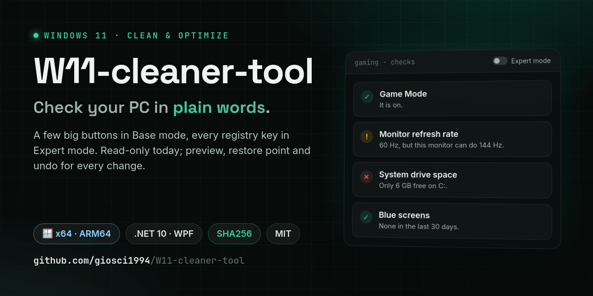

# 🧹 W11-cleaner-tool

**A simple cleaning and optimization tool for Windows 11 (Home and Pro): a few big buttons in
Base mode, every technical detail in Expert mode. One portable exe for x64 and ARM64, with
SHA256-verified releases.**

### 🌐 [giosci1994.github.io/W11-cleaner-tool](https://giosci1994.github.io/W11-cleaner-tool/)

<p align="center">
  <a href="https://github.com/giosci1994/W11-cleaner-tool/actions/workflows/build.yml"></a>
  <a href="https://github.com/giosci1994/W11-cleaner-tool/releases/latest"></a>
  
  
  
  <a href="LICENSE"></a>
  <a href="https://buymeacoffee.com/giosci1994u"></a>
</p>

<p align="center">
  
</p>

> **Status: version 0.1, read-only.** This version checks the PC and **changes nothing**.
> Cleaning, optimization and the other features will come later, always with a preview, a
> restore point and undo.

> **Note:** the app's interface is in Italian for now. The labels quoted below are the ones you
> will see on screen, with an English translation in brackets.

## Contents

- [Features](#-features)
- [Requirements](#-requirements)
- [Download and verify](#-download-and-verify)
- [Usage](#-usage)
- [Privacy and safety](#-privacy-and-safety)
- [Roadmap](#-roadmap)
- [Development](#-development)
- [Changelog](#-changelog)
- [Support](#-support)
- [License](#-license)

## ✨ Features

Two modes, one switch at the top: **«Modalità Esperto»** (Expert mode). The choice is remembered.

- **Base mode** — a few big cards and plain words. Every result is ✅ / ⚠️ / ❌ with one sentence
  on what it means and what to do.
- **Expert mode** — the same checks with the technical details: registry keys, values, versions.

| Card | What it checks |
|---|---|
| **Gaming** | Game Mode, hardware-accelerated GPU scheduling, power plan, monitor refresh rate vs. the maximum, memory integrity (reported only), Game Bar background recording, graphics driver, free space on the system drive, pending reboot |
| **RAM e driver** (RAM and drivers) | RAM speed vs. the rated speed (XMP / EXPO / DOCP, indicative), devices with errors, graphics, network and audio drivers with their date |
| **Problemi e crash** (Problems and crashes) | Blue screens, unexpected shutdowns, hardware errors (WHEA), apps that crash or hang, minidumps of the last 30 days, plus a **report to copy or save for an AI**, without user name, PC name or personal paths |

## ✅ Requirements

- **Windows 11** Home or Pro, **x64** (Intel / AMD) or **ARM64** (Snapdragon).
- Nothing to install: the exe is self-contained and already includes .NET.
- No administrator rights needed. In Expert mode, **«Riavvia come amministratore»** (Restart as
  administrator) also reads the minidumps.

## 📦 Download and verify

1. From the **[Releases](https://github.com/giosci1994/W11-cleaner-tool/releases)** page, download
   the right exe:
   - `W11-cleaner-tool-x64.exe` for Intel or AMD processors (almost every PC);
   - `W11-cleaner-tool-arm64.exe` for ARM processors (Snapdragon).
2. Download `SHA256SUMS.txt` and `VERIFY.ps1` into the same folder.
3. Check that the files are the original ones, in PowerShell:

   ```powershell
   powershell -ExecutionPolicy Bypass -File .\VERIFY.ps1
   ```

   or by hand: `Get-FileHash .\W11-cleaner-tool-x64.exe -Algorithm SHA256`, then compare the hash
   with `SHA256SUMS.txt`.

> **Windows SmartScreen:** the exe is not code-signed, so Windows may show a warning the first
> time. Click **More info → Run anyway**.

## 📖 Usage

1. Open the exe. On the left there are the cards; on the right, the results.
2. Click **«Controlla tutto»** (Check everything) or a single card: **Gaming**, **RAM e driver**,
   **Problemi e crash**.
3. Read the results: ✅ all good, ⚠️ worth a look, ❌ needs fixing. Each one says what to do.
4. In **Problemi e crash**, **«Copia il rapporto per l'IA»** (Copy the report for the AI) or
   **«Salva il rapporto…»** (Save the report) gives you an anonymized text to paste into an AI
   assistant.

Settings live in `%LOCALAPPDATA%\W11-cleaner-tool\settings.json`.

## 🔐 Privacy and safety

- **Read-only** in version 0.1: registry, WMI, event logs and Windows APIs are only read.
- The crash report removes the user name, the PC name, the domain and the profile paths.
- No telemetry, no network calls, no installation of apps.
- Every future feature that changes the system will have a **preview** (before → after), a
  **restore point**, a **change log** and **undo** — and is called "working" only after a test on
  a real PC.

## 🗺️ Roadmap

1. ✅ Read-only checks: gaming checklist, RAM and drivers, crash report for an AI.
2. No sleep while downloads are running (only while the app is open).
3. Cleaning: temporary files, caches, recycle bin — an estimate first.
4. Optimization: startup programs, power plan.
5. Debloat.
6. Duplicate files moved to quarantine, never deleted straight away.

## 💻 Development

The exe is built by **GitHub Actions** on a Windows runner:

- every push to `main` and every pull request: tests, x64 and ARM64 exe and `SHA256SUMS.txt` as a
  build artifact → [`.github/workflows/build.yml`](.github/workflows/build.yml);
- every `v*` tag: a release (marked pre-release while the version is 0.x) with both exe,
  `SHA256SUMS.txt` and `VERIFY.ps1` → [`.github/workflows/release.yml`](.github/workflows/release.yml).

On Windows with the **.NET 10 SDK**:

```powershell
dotnet test tests/W11CleanerTool.Tests/W11CleanerTool.Tests.csproj
./scripts/publish.ps1          # exe and SHA256SUMS.txt end up in artifacts/
```

### Project structure

```
src/W11CleanerTool/         WPF interface (.NET 10, Fluent theme, light/dark from Windows)
src/W11CleanerTool.Core/    the checks, no UI: gaming, hardware, crash report, anonymizer
tests/                      rule and anonymizer tests, smoke tests on the Windows runner
scripts/                    publish.ps1 (x64 + ARM64, SHA256) and VERIFY.ps1
docs/                       landing page, social preview, decisions, plan, research (Italian)
```

The project notes in `docs/` (decisions, plan, research on similar tools) are written in Italian.

## 📝 Changelog

Every version and what changed: [`CHANGELOG.md`](CHANGELOG.md).

## ☕ Support

If this tool is useful to you, you can support its development:
**[buymeacoffee.com/giosci1994u](https://buymeacoffee.com/giosci1994u)** ☕

## 📄 License

[MIT](LICENSE). No code is copied from other projects; ideas and known issues of similar tools are
collected in [`docs/ricerca-progetti-simili.md`](docs/ricerca-progetti-simili.md).
